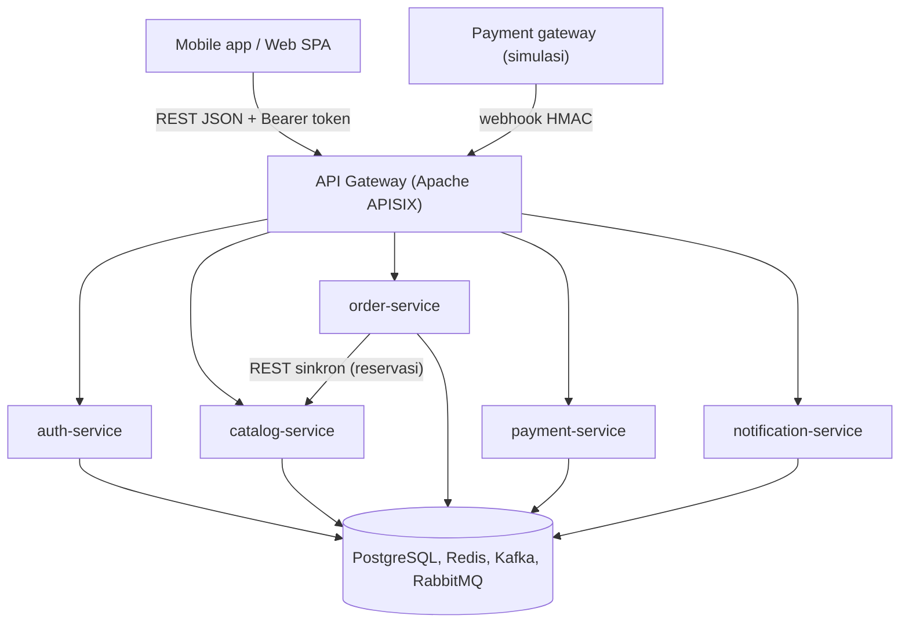
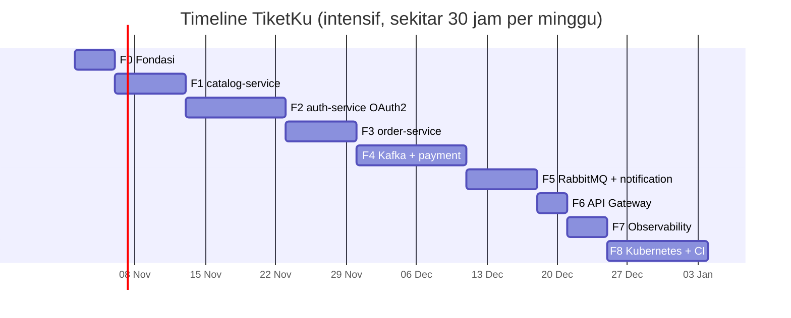

# TiketKu

Backend microservice untuk pemesanan tiket konser dan event, ditulis dengan **Rust**. Project belajar dengan studi kasus nyata: "war tiket" tanpa oversell, OAuth2 server buatan sendiri, event driven dengan Kafka, job dengan RabbitMQ, API Gateway, dan deploy ke Kubernetes.

- Spesifikasi lengkap soal: [docs/SOAL.md](docs/SOAL.md)
- Board agile (user story): [TiketKu Board](https://github.com/users/adityars-sidqi/projects/8)
- Deadline per fase: [Milestones](https://github.com/adityars-sidqi/tiketku/milestones)

> Status: belum ada kode. Fase 0 dimulai **Senin, 2 November 2026**.

## Arsitektur



| Bagian | Pilihan |
| --- | --- |
| Bahasa dan framework | Rust stable (edition 2024), Axum, Tokio, sqlx |
| Database | PostgreSQL (satu database per service), Redis |
| Event dan message broker | Apache Kafka (KRaft), RabbitMQ |
| Auth | OAuth2 Authorization Server sendiri (Authorization Code + PKCE, refresh token, client credentials), JWT RS256 |
| Gateway | Apache APISIX |
| Deploy | Docker, Kubernetes (kind/k3d), Kustomize, operator Strimzi, CloudNativePG, RabbitMQ |
| Observability | OpenTelemetry, Jaeger, Prometheus, Grafana |

## Timeline dan deadline

Ritme intensif, sekitar 30 jam per minggu, total 9 minggu. Deadline adalah akhir hari (23:59 WIB) pada tanggal tersebut.

| Fase | Fokus | Mulai | Deadline | Milestone |
| --- | --- | --- | --- | --- |
| F0 | Fondasi: workspace, docker-compose, crate `common` | Sen, 2 Nov 2026 | **Kam, 5 Nov 2026** | [F0](https://github.com/adityars-sidqi/tiketku/milestone/1) |
| F1 | catalog-service | Jum, 6 Nov 2026 | **Kam, 12 Nov 2026** | [F1](https://github.com/adityars-sidqi/tiketku/milestone/2) |
| F2 | auth-service (OAuth2) | Jum, 13 Nov 2026 | **Min, 22 Nov 2026** | [F2](https://github.com/adityars-sidqi/tiketku/milestone/3) |
| F3 | order-service, anti-oversell, rate limit | Sen, 23 Nov 2026 | **Min, 29 Nov 2026** | [F3](https://github.com/adityars-sidqi/tiketku/milestone/4) |
| F4 | Kafka + payment-service, saga | Sen, 30 Nov 2026 | **Kam, 10 Des 2026** | [F4](https://github.com/adityars-sidqi/tiketku/milestone/5) |
| F5 | RabbitMQ + notification-service | Jum, 11 Des 2026 | **Kam, 17 Des 2026** | [F5](https://github.com/adityars-sidqi/tiketku/milestone/6) |
| F6 | API Gateway (APISIX) | Jum, 18 Des 2026 | **Min, 20 Des 2026** | [F6](https://github.com/adityars-sidqi/tiketku/milestone/7) |
| F7 | Observability | Sen, 21 Des 2026 | **Kam, 24 Des 2026** | [F7](https://github.com/adityars-sidqi/tiketku/milestone/8) |
| F8 | Kubernetes + CI/CD | Jum, 25 Des 2026 | **Min, 3 Jan 2027** | [F8](https://github.com/adityars-sidqi/tiketku/milestone/9) |



**Aturan deadline**

1. Deadline tidak digeser. Kalau terlambat, potong scope, bukan tanggal.
2. Story **P0 (wajib)** harus selesai sebelum fase berikutnya dimulai. Story **P1** yang belum selesai dipindah ke milestone berikutnya dengan label `carry-over`.
3. Setiap Minggu malam, review board: tutup story yang selesai, cek apakah fase aktif masih sesuai jalur, dan tulis catatan singkat di deskripsi milestone jika ada keterlambatan.
4. F8 jatuh di libur Natal dan Tahun Baru. Rencanakan waktunya dari awal.
5. Story **P2 (bonus)** ada di milestone Bonus tanpa deadline; kerjakan hanya setelah F8 selesai.

## Cara kerja dengan board

Kolom board: **Backlog → Ready → In Progress → In Review → Done**. Story fase aktif ada di Ready; sisanya di Backlog sampai fasenya tiba.

[TiketKu Board](https://github.com/users/adityars-sidqi/projects/8) punya empat view:

| View | Isi |
| --- | --- |
| Backlog | Tabel semua story dengan Status, Fase, Prioritas, Story Points, Target |
| Board | Kanban semua fase (tanpa Bonus) |
| Fase aktif | Kanban yang difilter ke fase berjalan (`fase:F0`); dipakai sehari-hari |
| Roadmap | Garis waktu story berdasarkan field Mulai dan Target |

1. Buka view **Fase aktif**, ambil story teratas di **Ready** (P0 dulu).
2. Assign ke diri sendiri, pindahkan ke **In Progress**.
3. Buat branch `story/<nomor-issue>-<slug>`, contoh `story/16-login-pkce`.
4. Commit kecil-kecil. Buka PR dengan `Closes #<nomor-issue>`, pindahkan kartu ke **In Review**.
5. Merge setelah semua kriteria penerimaan tercentang dan CI hijau. Issue tertutup otomatis dan kartu pindah ke **Done**.
6. Saat fase baru dimulai, pindahkan story fase itu dari Backlog ke Ready, lalu ubah filter view **Fase aktif** (mis. `fase:F1`) dan simpan.

**Definition of Done** untuk setiap story:

- Semua kriteria penerimaan di issue tercentang.
- Ada test untuk perilaku baru (unit atau integration), dan `cargo test` lulus.
- `cargo fmt --check` dan `cargo clippy --all-targets -- -D warnings` bersih.
- Endpoint baru tercatat di OpenAPI; keputusan desain penting dicatat di README atau `docs/`.

## Tim agent Claude Code

Sesi utama (**main-agent**) mengoordinasi pekerjaan dan mengerjakan backend Rust. Untuk peran lain, main-agent mendelegasikan ke subagent yang didefinisikan di [`.claude/agents/`](.claude/agents/):

| Agent | Peran | Area kerja |
| --- | --- | --- |
| `ui-ux-designer` | User flow, wireframe, design system, spesifikasi layar, aksesibilitas | `docs/design/` di repo ini |
| `fe-web-developer` | Web customer dan dashboard organizer (SvelteKit + TypeScript) | `../tiketku-web` |
| `fe-mobile-developer` | Aplikasi customer Android dan iOS (Flutter) | `../tiketku-mobile` |
| `qa-automation` | Test plan dari kriteria penerimaan, test otomatis API, web, mobile, dan beban | `tests/` di repo ini, `e2e/` web, `integration_test/` mobile |

Urutan kerja untuk fitur yang punya tampilan: `ui-ux-designer` → `fe-web-developer` / `fe-mobile-developer` → `qa-automation`. Agent FE membutuhkan repo `tiketku-web` dan `tiketku-mobile` sejajar dengan repo ini.

## Struktur repo (rencana)

```text
tiketku/
├── crates/        # common, auth-jwt, messaging, ratelimit
├── services/      # auth, catalog, order, payment, notification
├── tools/         # pg-simulator
├── deploy/        # docker-compose, apisix, k8s (Kustomize)
└── docs/          # SOAL.md dan catatan desain
```
