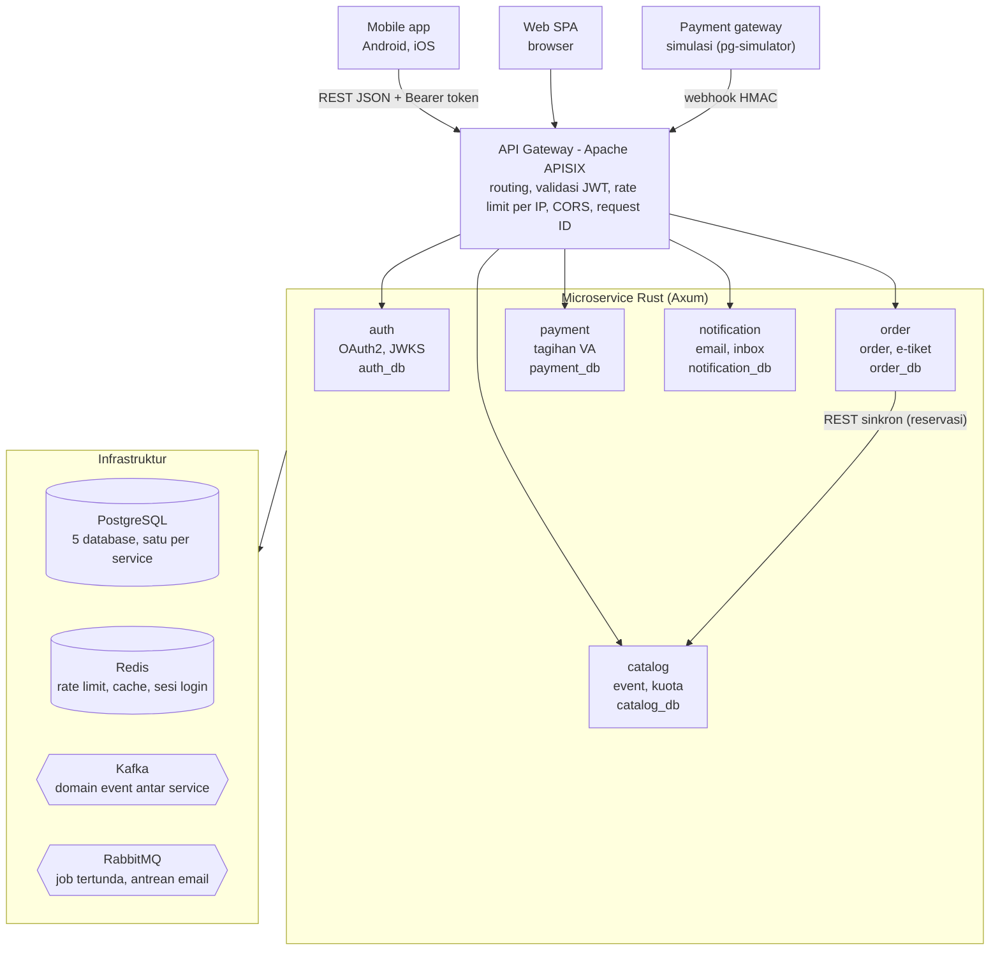
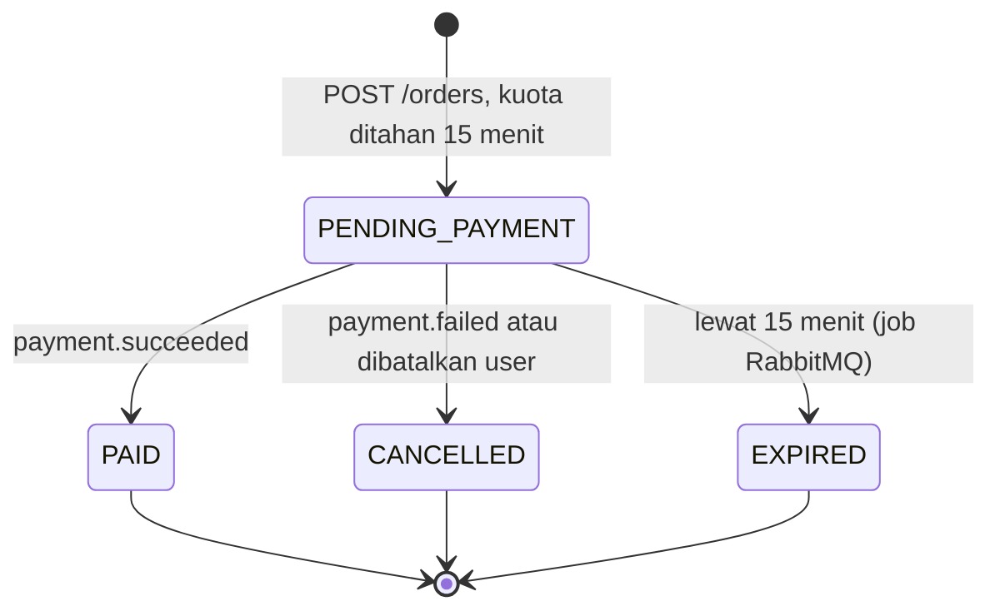
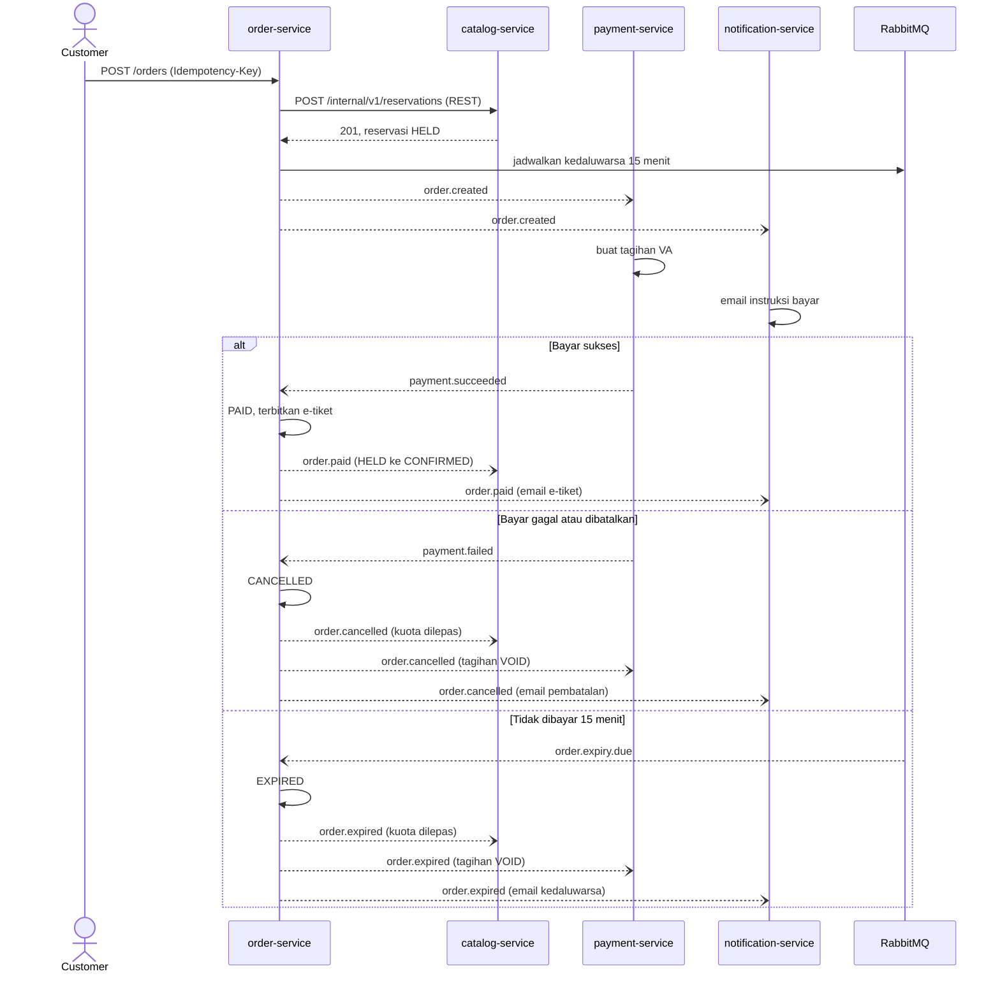

# Soal Project Rust: TiketKu — Backend Microservice Pemesanan Tiket Event

Versi 30 Oktober 2026 · Aditya Rahman Sidqi

> Ini spesifikasi soal. Deadline tiap fase ada di [README](../README.md#timeline-dan-deadline) dan di milestone GitHub; progres dilacak di board GitHub Project.

## Ringkasan soal

Bangun backend **TiketKu**, platform pemesanan tiket konser dan event, sebagai 5 microservice Rust di belakang API Gateway, lalu deploy ke Kubernetes. Level **medium**: alur bisnisnya sederhana (lihat event → pesan → bayar → terima e-tiket), tantangannya ada di konsistensi data antar service, konkurensi saat "war tiket", dan keamanan.

| Aspek | Ketentuan |
| --- | --- |
| Bahasa | Rust stable, edition 2024 |
| Gaya API | RESTful JSON, versi di path (`/api/v1/...`) |
| Konsumen | Aplikasi mobile (Android/iOS) dan web (SPA) |
| Jumlah service | 5: auth, catalog, order, payment, notification |
| Komponen wajib | Microservice, Kafka (event driven), RabbitMQ (message broker), rate limit, API Gateway, OAuth2 server buatan sendiri |
| Target deploy | Kubernetes (lokal: kind atau k3d) |

**Konsep Rust yang dilatih:**

- Ownership dan borrowing pada state bersama: `Arc<AppState>`, pool koneksi yang murah di-`clone`.
- Trait dan generic untuk repository, supaya logika bisnis bisa dites tanpa database.
- Enum dan pattern matching untuk state machine order, sehingga status tidak valid tidak bisa dibuat.
- Error handling: `thiserror`, operator `?`, dan konversi error ke HTTP response lewat `IntoResponse`.
- Async dengan Tokio: `tokio::spawn`, `tokio::select!`, channel, dan graceful shutdown.
- Newtype (`OrderId`, `Email`, `Rupiah`) agar nilai dengan tipe dasar sama tidak tertukar.
- Query yang dicek saat compile (`sqlx::query!`) dan Cargo workspace dengan banyak binary.

## Studi kasus: TiketKu

Saat tiket konser populer dibuka, ribuan orang membeli di menit yang sama. Sistem wajib: tidak pernah menjual melebihi kuota (oversell), tetap responsif saat lonjakan, melepas tiket yang tidak dibayar dalam 15 menit, dan mengirim e-tiket setelah lunas.

**Aktor**

| Aktor | Role / jenis akses | Yang bisa dilakukan |
| --- | --- | --- |
| Customer | `customer` | Daftar, login, lihat event, pesan, bayar, lihat e-tiket |
| Organizer | `organizer` | Buat event dan kategori tiket, publish event, lihat penjualan event miliknya |
| Admin | `admin` | Kelola user dan role, daftarkan OAuth2 client |
| Payment gateway (simulasi) | Webhook bertanda tangan HMAC | Mengirim hasil pembayaran |
| Service internal | OAuth2 `client_credentials` | Memanggil endpoint internal antar service |

**Fitur dalam scope**

- Registrasi dan login lewat OAuth2 Authorization Code + PKCE.
- Katalog event: daftar, cari, filter kota dan tanggal, detail dengan sisa kuota.
- Organizer membuat event dan kategori tiket (mis. VIP, Festival) dengan harga, kuota, batas tiket per order, dan jadwal penjualan.
- Pemesanan dengan reservasi kuota 15 menit dan header `Idempotency-Key`.
- Pembayaran virtual account (simulasi) dengan webhook.
- E-tiket berkode unik setelah lunas.
- Notifikasi email dan inbox notifikasi di aplikasi.

Di luar scope: refund otomatis, pemilihan kursi (seat map), payment gateway asli, dan frontend.

**Alur utama (happy path)**

1. Customer login, aplikasi mendapat access token.
2. Customer membuka daftar event dan memilih kategori tiket.
3. Customer membuat order. catalog-service menahan kuota secara atomik; order berstatus `PENDING_PAYMENT` dan berlaku 15 menit.
4. payment-service membuat tagihan virtual account setelah menerima event `order.created`.
5. Customer membayar, payment gateway mengirim webhook, payment-service menerbitkan `payment.succeeded`.
6. order-service mengubah order menjadi `PAID`, membuat e-tiket, lalu menerbitkan `order.paid`.
7. catalog-service mengubah reservasi menjadi terjual; notification-service mengirim email e-tiket.

**Jalur gagal**

- Tidak dibayar dalam 15 menit: order menjadi `EXPIRED`, kuota dilepas, customer diberi tahu.
- Pembayaran gagal atau customer membatalkan: order menjadi `CANCELLED`, kuota dilepas.
- Kuota habis saat memesan: response `409 Conflict` dengan kode `SOLD_OUT`.

## Arsitektur sistem

Semua request dari mobile dan web masuk lewat API Gateway, diteruskan ke 5 service yang masing-masing punya database sendiri. Antar service hanya ada satu panggilan sinkron; sisanya lewat Kafka (event) dan RabbitMQ (job).



Satu-satunya panggilan sinkron antar service adalah order → catalog untuk reservasi kuota; sisanya lewat Kafka dan RabbitMQ.

| Service | Tanggung jawab | Data miliknya | Publish ke Kafka | Consume dari Kafka |
| --- | --- | --- | --- | --- |
| auth-service | User, password, OAuth2 Authorization Server, JWKS | `auth_db`, Redis (authorization code, sesi login) | `user.registered` | – |
| catalog-service | Event, kategori tiket, kuota dan reservasi | `catalog_db`, Redis (cache) | – | `order.paid`, `order.cancelled`, `order.expired` |
| order-service | Order, state machine, e-tiket | `order_db` | `order.created`, `order.paid`, `order.cancelled`, `order.expired` | `payment.succeeded`, `payment.failed` |
| payment-service | Tagihan virtual account, webhook, status bayar | `payment_db` | `payment.succeeded`, `payment.failed` | `order.created`, `order.cancelled`, `order.expired` |
| notification-service | Email, inbox notifikasi | `notification_db` | – | `user.registered`, `order.created`, `order.paid`, `order.cancelled`, `order.expired` |

Tambahan: satu binary CLI `pg-simulator` (Rust, `clap` + `reqwest`) yang berperan sebagai payment gateway palsu dan mengirim webhook bertanda tangan HMAC.

**Aturan komunikasi**

- Client hanya bicara ke API Gateway. Service tidak pernah diekspos langsung ke internet.
- **Sinkron (REST internal)** hanya untuk hal yang jawabannya dibutuhkan saat itu juga: order-service → catalog-service `POST /internal/v1/reservations`. Customer harus langsung tahu dapat tiket atau tidak. Pakai token `client_credentials`, timeout 2 detik, dan `reservation_id = order_id` supaya aman di-retry.
- **Kafka** untuk domain event: fakta yang sudah terjadi dan boleh didengar banyak service ("order sudah dibayar").
- **RabbitMQ** untuk job: perintah dengan satu penerima yang butuh penundaan atau retry ("kedaluwarsakan order ini 15 menit lagi", "kirim email ini").
- **Database per service**: tidak ada service yang membaca atau menulis database milik service lain.
- Setiap service memvalidasi JWT sendiri lewat JWKS walaupun gateway sudah memvalidasi (defense in depth).

## Database dan infrastruktur

Database utama wajib **PostgreSQL**, satu database per service. Redis untuk data sementara yang butuh kecepatan, Kafka dan RabbitMQ untuk komunikasi async.

| Komponen | Pilihan | Dipakai untuk | Alasan |
| --- | --- | --- | --- |
| Database utama | PostgreSQL 17 atau lebih baru | Semua data bisnis: `auth_db`, `catalog_db`, `order_db`, `payment_db`, `notification_db` | Transaksi ACID untuk order dan pembayaran, `CHECK` constraint untuk kuota, `FOR UPDATE SKIP LOCKED` untuk outbox, JSONB untuk payload event, didukung penuh oleh `sqlx` |
| Cache dan counter | Redis 7 (atau Valkey) | Rate limit, cache katalog, authorization code, sesi login | Operasi atomik (`INCR`, Lua script), TTL bawaan, latensi sangat rendah |
| Event streaming | Apache Kafka 4.x, mode KRaft (tanpa ZooKeeper) | Domain event antar service | Event tersimpan sebagai log yang bisa di-replay, banyak consumer group membaca event yang sama, urutan terjamin per partition key |
| Message broker | RabbitMQ 4.x (quorum queue) | Job tertunda (kedaluwarsa order) dan antrean email dengan retry + dead letter queue | TTL + dead-letter exchange untuk delay, ack dan retry per pesan; hal yang tidak alami di Kafka |
| API Gateway | Apache APISIX | Routing, validasi JWT, rate limit global, CORS, request ID | Open source (Apache 2.0), plugin lengkap tanpa edisi berbayar, punya Ingress Controller untuk Kubernetes |
| SMTP (dev) | Mailpit | Menangkap email di lokal | Ada web UI untuk melihat email yang terkirim |
| Observability | OpenTelemetry Collector, Jaeger, Prometheus, Grafana | Tracing, metrics, dashboard | Standar terbuka, semua jalan di Kubernetes |

**Kenapa bukan MongoDB?** Order dan pembayaran butuh transaksi lintas tabel dan constraint seperti `reserved + sold <= quota`. Model relasional menjaga aturan itu langsung di database.

**Konvensi data**

- Uang disimpan sebagai `BIGINT` dalam rupiah penuh. Jangan pernah `f64` untuk uang.
- Waktu disimpan sebagai `TIMESTAMPTZ` (UTC) dan dikirim di JSON dalam format RFC 3339.
- ID memakai UUID v7, yang terurut waktu sehingga ramah index.
- Di lokal cukup satu container Postgres berisi 5 database. Di Kubernetes, tiap service punya user database sendiri yang hanya berhak atas database miliknya.

## Framework dan library Rust

Framework web wajib **Axum** di atas **Tokio**. Axum dibuat tim Tokio dan berbasis `tower`, jadi middleware (timeout, trace, rate limit) bisa dipakai ulang di semua service.

| Kebutuhan | Crate | Catatan |
| --- | --- | --- |
| Web framework | `axum`, `tower`, `tower-http` | Router, extractor, middleware trace, CORS, timeout, request ID |
| Async runtime | `tokio`, `tokio-util` | `CancellationToken` untuk graceful shutdown worker |
| Serialisasi | `serde`, `serde_json` | Semua field JSON `snake_case` |
| Validasi input | `validator` | Derive `Validate` pada DTO request |
| Database | `sqlx` (fitur `postgres`, `runtime-tokio`, `tls-rustls`, `uuid`, `chrono`, `migrate`) | Query dicek saat compile, migrasi berbasis file SQL |
| Redis | `redis` (fitur `tokio-comp`, `connection-manager`) | Rate limit dengan Lua script, cache, simpan authorization code |
| Kafka | `rdkafka` | Binding ke librdkafka: `FutureProducer` dan `StreamConsumer` |
| RabbitMQ | `lapin` | Klien AMQP 0-9-1 async |
| JWT | `jsonwebtoken` | Tanda tangan dan verifikasi RS256 |
| Hash password | `argon2` | Argon2id |
| Kripto pendukung | `rsa`, `sha2`, `base64`, `hmac`, `rand` | Export kunci publik ke JWKS, PKCE S256, hash refresh token, tanda tangan webhook |
| HTTP client | `reqwest` | Panggilan internal dan ambil JWKS |
| Template HTML | `askama` | Halaman login OAuth2 dan isi email |
| Email | `lettre` | SMTP ke Mailpit |
| Konfigurasi | `config` (atau `figment`), `dotenvy` | Semua konfigurasi dari environment variable |
| Error | `thiserror`, `anyhow` | `thiserror` untuk error domain, `anyhow` hanya di `main` |
| Log dan tracing | `tracing`, `tracing-subscriber` (format JSON), `tracing-opentelemetry`, `opentelemetry-otlp` | Trace ID ikut di setiap log |
| Metrics | `metrics`, `metrics-exporter-prometheus` | Endpoint `/metrics` |
| Dokumentasi API | `utoipa`, `utoipa-swagger-ui` | OpenAPI 3 untuk setiap service |
| ID dan waktu | `uuid` (fitur `v7`, `serde`), `chrono` (fitur `serde`) |  |
| CLI | `clap` | Untuk `pg-simulator` |
| Testing | `testcontainers`, `testcontainers-modules`, `tower` (`ServiceExt::oneshot`) | Integration test dengan Postgres, Redis, Kafka asli di container |

**Tool pendukung:** `sqlx-cli` (migrasi), `cargo-chef` (cache build Docker), `cargo-audit` (cek kerentanan dependency), `clippy` dan `rustfmt`.

**Versi:** pakai versi stabil terbaru dari crates.io. `cargo add` otomatis memilih versi terbaru. Simpan versinya di `[workspace.dependencies]` agar semua service seragam.

```bash
cargo add axum tower tower-http tokio serde serde_json --features tokio/full,serde/derive,tower-http/trace,tower-http/cors,tower-http/timeout,tower-http/request-id
```

**Catatan untuk Windows:** `rdkafka` meng-compile librdkafka (butuh CMake dan compiler C). Supaya tidak repot, kerjakan project ini di WSL2 atau Dev Container.

## Struktur project dan konvensi REST API

Semua kode ada di satu repo (monorepo) berupa Cargo workspace. Crate bersama hanya berisi infrastruktur, bukan model domain, supaya service tidak saling terikat.

```text
tiketku/
├── Cargo.toml                # [workspace] + [workspace.dependencies]
├── crates/
│   ├── common/               # config, tracing, AppError -> problem+json, health, shutdown
│   ├── auth-jwt/             # extractor AuthUser: verifikasi JWT via JWKS, cek scope
│   ├── messaging/            # envelope event, outbox relay, helper Kafka dan RabbitMQ
│   └── ratelimit/            # rate limiter berbasis Redis + layer tower
├── services/
│   ├── auth-service/
│   ├── catalog-service/
│   ├── order-service/
│   ├── payment-service/
│   └── notification-service/
├── tools/pg-simulator/       # payment gateway palsu (CLI)
├── deploy/
│   ├── docker-compose.yml
│   ├── apisix/
│   └── k8s/                  # base/, overlays/dev, overlays/prod (Kustomize)
└── .github/workflows/ci.yml
```

Isi tiap service mengikuti pola yang sama:

```text
services/order-service/
├── migrations/               # 0001_init.sql, 0002_...
└── src/
    ├── main.rs               # baca config, bangun AppState, jalankan HTTP + worker
    ├── config.rs
    ├── state.rs              # AppState { db, redis, producer, ... }
    ├── http/                 # router, handler, DTO request/response
    ├── domain/               # entity, enum status, aturan bisnis (tanpa I/O)
    ├── repo/                 # trait repository + implementasi sqlx
    ├── events/               # outbox dan consumer Kafka
    └── jobs/                 # consumer RabbitMQ dan worker background
```

Aturan: modul `domain/` tidak boleh meng-import `axum` atau `sqlx`, supaya aturan bisnis bisa di-unit test murni.

**Konvensi REST**

- Base path `/api/v1`, nama resource jamak: `/orders`, `/events/{id}/ticket-categories`.
- `GET` membaca, `POST` membuat atau menjalankan aksi, `PATCH` mengubah sebagian, `DELETE` menghapus.
- Status code: `200`, `201` + header `Location`, `204`, `400` (format salah), `401` (token tidak ada atau tidak valid), `403` (role atau scope kurang), `404`, `409` (konflik, mis. `SOLD_OUT`), `422` (validasi gagal), `429` (kena rate limit), `503`.
- Pagination: `?page=1&page_size=20` (maksimal 100), response `{"data": [...], "meta": {"page", "page_size", "total"}}`.
- Header: `Authorization: Bearer <jwt>`, `Idempotency-Key` (wajib di `POST /orders`), `X-Request-Id` (dibuat gateway, diteruskan ke service lain dan ke event), `traceparent` (W3C Trace Context).
- Setiap service punya `GET /health/live`, `GET /health/ready` (cek DB, Redis, broker), `GET /metrics`, dan `GET /docs` (Swagger UI, mati di production).
- Endpoint antar service memakai prefix `/internal/v1/...` dan tidak pernah diteruskan oleh gateway.

Semua error memakai format **RFC 9457 Problem Details** (`Content-Type: application/problem+json`):

```json
{
  "type": "https://tiketku.example/problems/sold-out",
  "title": "Tiket habis",
  "status": 409,
  "detail": "Kuota kategori Festival sudah habis",
  "instance": "/api/v1/orders",
  "code": "SOLD_OUT",
  "request_id": "0192f3a1-7c2e-7b10-9d4e-3f5a6b7c8d9e"
}
```

Error validasi (`422`) menambahkan field `errors: [{"field": "quantity", "message": "maksimal 4"}]`.

## Spesifikasi service dan endpoint

Path di bawah adalah path publik lewat gateway. Kolom Akses menyebut role atau scope minimal; "Pemilik" berarti `sub` di token harus sama dengan pemilik data.

### auth-service

| Method | Path | Akses | Keterangan |
| --- | --- | --- | --- |
| POST | `/api/v1/auth/register` | Publik | Daftar customer: `email`, `password`, `full_name`, `phone`. Response `201` |
| GET | `/oauth2/authorize` | Publik (browser) | Mulai Authorization Code + PKCE. Tampilkan halaman login jika belum ada sesi |
| POST | `/oauth2/login` | Publik (form) | Proses form login, set cookie sesi, redirect kembali ke `/oauth2/authorize` |
| POST | `/oauth2/token` | Client terdaftar | `grant_type`: `authorization_code`, `refresh_token`, `client_credentials` |
| POST | `/oauth2/revoke` | Client terdaftar | Cabut refresh token (logout), RFC 7009 |
| POST | `/oauth2/introspect` | Client confidential | Cek status token, RFC 7662 (opsional) |
| GET | `/.well-known/oauth-authorization-server` | Publik | Metadata server, RFC 8414 (isi yang sama juga disajikan di /.well-known/openid-configuration untuk gateway) |
| GET | `/.well-known/jwks.json` | Publik | Kunci publik untuk verifikasi JWT |
| GET | `/api/v1/users/me` | Bearer | Profil user yang login |
| PATCH | `/api/v1/users/me` | Bearer | Ubah nama dan nomor telepon |
| POST | `/api/v1/users/me/password` | Bearer | Ganti password (wajib password lama), lalu cabut semua refresh token |
| PATCH | `/api/v1/admin/users/{id}/role` | `admin` | Ubah role user |
| POST | `/api/v1/admin/oauth-clients` | `admin` | Daftarkan OAuth2 client baru |

Aturan: password 8–128 karakter; email unik tanpa membedakan huruf besar-kecil; pesan login gagal selalu "Email atau password salah" tanpa membedakan email tidak ada atau password salah.

### catalog-service

| Method | Path | Akses | Keterangan |
| --- | --- | --- | --- |
| GET | `/api/v1/events` | Publik | Filter `city`, `date_from`, `date_to`, `q`. Hanya event `PUBLISHED`. Cache Redis 30 detik |
| GET | `/api/v1/events/{id}` | Publik | Detail event, kategori tiket, dan `available` per kategori |
| POST | `/api/v1/events` | `organizer`, scope `events:write` | Buat event berstatus `DRAFT` |
| PATCH | `/api/v1/events/{id}` | Organizer pemilik | Ubah event selama masih `DRAFT` |
| POST | `/api/v1/events/{id}/publish` | Organizer pemilik | `DRAFT` → `PUBLISHED`, minimal punya 1 kategori tiket |
| POST | `/api/v1/events/{id}/ticket-categories` | Organizer pemilik | `name`, `price`, `quota`, `max_per_order` (1–10), `sales_start`, `sales_end` |
| GET | `/api/v1/organizer/events/{id}/sales` | Organizer pemilik | Per kategori: quota, reserved, sold, pendapatan |
| POST | `/internal/v1/reservations` | Token `client_credentials`, scope `internal:reservations` | Body `reservation_id`, `ticket_category_id`, `quantity`. `201` berisi harga dan snapshot event; `409` dengan kode `SOLD_OUT`, `NOT_ON_SALE`, atau `LIMIT_EXCEEDED` |

Aturan: `available = quota - reserved - sold`. Reservasi harus atomik dan idempotent (`reservation_id` yang sama mengembalikan hasil yang sama). Cache boleh sedikit basi; pengecekan final selalu di database saat reservasi.

### order-service

| Method | Path | Akses | Keterangan |
| --- | --- | --- | --- |
| POST | `/api/v1/orders` | `customer`, scope `orders:write`, header `Idempotency-Key` | Body `ticket_category_id`, `quantity`. `201` berisi `order_id`, `status`, `total_amount`, `expires_at`. Rate limit 5 request/menit/user |
| GET | `/api/v1/orders` | Bearer | Order milik sendiri, filter `status` |
| GET | `/api/v1/orders/{id}` | Pemilik | Order milik orang lain dijawab `404`, bukan `403`, supaya ID tidak bisa dipancing |
| POST | `/api/v1/orders/{id}/cancel` | Pemilik | Hanya saat `PENDING_PAYMENT` |
| GET | `/api/v1/orders/{id}/tickets` | Pemilik | Daftar e-tiket (`ticket_code`) setelah `PAID` |

Aturan:

- Harga diambil dari catalog-service, tidak pernah dari body request. Order menyimpan snapshot harga, nama event, dan tanggal event.
- Satu user maksimal punya 1 order `PENDING_PAYMENT` per event (mencegah borong tiket).
- `Idempotency-Key` yang sama dengan body sama mengembalikan response pertama (disimpan 24 jam). Key sama dengan body berbeda dijawab `422` kode `IDEMPOTENCY_KEY_REUSED`.
- `ticket_code` acak 12 karakter, tidak berurutan dan tidak bisa ditebak.
- Perubahan status wajib lewat state machine berikut. Transisi lain ditolak dengan `409` kode `INVALID_STATE`.



Implementasikan sebagai enum dengan satu method transisi. Update di database tetap memakai `WHERE status = 'PENDING_PAYMENT'`, supaya dua event yang datang bersamaan (mis. bayar dan kedaluwarsa) tidak sama-sama menang.

```rust
#[derive(Debug, Clone, Copy, PartialEq, Eq)]
pub enum OrderStatus { PendingPayment, Paid, Cancelled, Expired }

pub enum OrderEvent { PaymentSucceeded, PaymentFailed, CancelledByUser, Timeout }

impl OrderStatus {
    pub fn transition(self, event: OrderEvent) -> Result<OrderStatus, DomainError> {
        use OrderEvent::*;
        use OrderStatus::*;
        match (self, event) {
            (PendingPayment, PaymentSucceeded) => Ok(Paid),
            (PendingPayment, PaymentFailed | CancelledByUser) => Ok(Cancelled),
            (PendingPayment, Timeout) => Ok(Expired),
            (from, _) => Err(DomainError::InvalidState(from)),
        }
    }
}
```

### payment-service

| Method | Path | Akses | Keterangan |
| --- | --- | --- | --- |
| GET | `/api/v1/payments?order_id={id}` | Pemilik order | Instruksi bayar: `va_number`, `amount`, `expires_at`, `status`. Selama tagihan belum terbentuk, jawab `404` dan client mengulang (polling) |
| GET | `/api/v1/payments/{id}` | Pemilik | Detail pembayaran |
| POST | `/webhooks/payment-gateway` | Publik, wajib tanda tangan HMAC | Header `X-PG-Timestamp`, `X-PG-Signature`. Body `gateway_txn_id`, `va_number`, `amount`, `status` (`PAID`/`FAILED`), `paid_at` |

Aturan:

- Signature = HMAC-SHA256(secret, `timestamp + "." + raw_body`). Bandingkan secara constant-time. Tolak jika timestamp lebih dari 5 menit dari waktu server (anti replay).
- Webhook idempotent berdasarkan `gateway_txn_id`; webhook yang sama dua kali tetap `200` tanpa efek ganda.
- `amount` harus sama persis dengan tagihan; jika tidak, tolak dan catat.
- Pembayaran yang datang setelah order kedaluwarsa ditandai `LATE_PAID` untuk refund manual (tidak menghidupkan order lagi).

### notification-service

| Method | Path | Akses | Keterangan |
| --- | --- | --- | --- |
| GET | `/api/v1/notifications` | Bearer | Inbox notifikasi milik user, terbaru dulu |
| POST | `/api/v1/notifications/{id}/read` | Pemilik | Tandai sudah dibaca |

Aturan: notification-service tidak memanggil auth-service untuk mencari email user. Ia menyimpan salinan lokal `user_contacts` dari event `user.registered` (pola *event-carried state transfer*). Template email: selamat datang, instruksi bayar, e-tiket, order kedaluwarsa, order dibatalkan.

## Skema database

Skema minimal berikut wajib ada; kolom tambahan boleh. Tulis sebagai file migrasi `sqlx` di folder `migrations/` tiap service. Tidak ada foreign key lintas service: `user_id` di service lain hanyalah UUID biasa.

### auth\_db

```sql
CREATE TABLE users (
    id                 UUID PRIMARY KEY,
    email              TEXT NOT NULL,
    password_hash      TEXT NOT NULL,           -- string PHC Argon2id
    full_name          TEXT NOT NULL,
    phone              TEXT,
    role               TEXT NOT NULL DEFAULT 'customer'
                       CHECK (role IN ('customer', 'organizer', 'admin')),
    is_active          BOOLEAN NOT NULL DEFAULT TRUE,
    failed_login_count INT NOT NULL DEFAULT 0,
    locked_until       TIMESTAMPTZ,
    created_at         TIMESTAMPTZ NOT NULL DEFAULT now(),
    updated_at         TIMESTAMPTZ NOT NULL DEFAULT now()
);
CREATE UNIQUE INDEX users_email_uq ON users (lower(email));

CREATE TABLE oauth_clients (
    client_id          TEXT PRIMARY KEY,
    client_secret_hash TEXT,                    -- NULL untuk public client (mobile, SPA)
    name               TEXT NOT NULL,
    client_type        TEXT NOT NULL CHECK (client_type IN ('public', 'confidential')),
    redirect_uris      TEXT[] NOT NULL DEFAULT '{}',
    grant_types        TEXT[] NOT NULL,
    scopes             TEXT[] NOT NULL,
    created_at         TIMESTAMPTZ NOT NULL DEFAULT now()
);

CREATE TABLE refresh_tokens (
    id          UUID PRIMARY KEY,
    token_hash  BYTEA NOT NULL UNIQUE,          -- SHA-256 token; token asli tidak disimpan
    family_id   UUID NOT NULL,                  -- satu family = satu sesi login
    user_id     UUID NOT NULL REFERENCES users (id),
    client_id   TEXT NOT NULL REFERENCES oauth_clients (client_id),
    scope       TEXT NOT NULL,
    expires_at  TIMESTAMPTZ NOT NULL,
    revoked_at  TIMESTAMPTZ,
    replaced_by UUID,
    created_at  TIMESTAMPTZ NOT NULL DEFAULT now()
);
CREATE INDEX refresh_tokens_family_idx ON refresh_tokens (family_id);
```

Authorization code dan sesi login disimpan di Redis, bukan Postgres: `oauth:code:<sha256>` (TTL 60 detik, sekali pakai) dan `session:<id>` (TTL 8 jam).

### catalog\_db

```sql
CREATE TABLE events (
    id           UUID PRIMARY KEY,
    organizer_id UUID NOT NULL,
    title        TEXT NOT NULL,
    description  TEXT NOT NULL DEFAULT '',
    venue_name   TEXT NOT NULL,
    city         TEXT NOT NULL,
    starts_at    TIMESTAMPTZ NOT NULL,
    ends_at      TIMESTAMPTZ NOT NULL,
    status       TEXT NOT NULL DEFAULT 'DRAFT'
                 CHECK (status IN ('DRAFT', 'PUBLISHED', 'CANCELLED')),
    created_at   TIMESTAMPTZ NOT NULL DEFAULT now(),
    updated_at   TIMESTAMPTZ NOT NULL DEFAULT now(),
    CHECK (ends_at > starts_at)
);

CREATE TABLE ticket_categories (
    id            UUID PRIMARY KEY,
    event_id      UUID NOT NULL REFERENCES events (id),
    name          TEXT NOT NULL,
    price         BIGINT NOT NULL CHECK (price >= 0),
    quota         INT NOT NULL CHECK (quota > 0),
    reserved      INT NOT NULL DEFAULT 0 CHECK (reserved >= 0),
    sold          INT NOT NULL DEFAULT 0 CHECK (sold >= 0),
    max_per_order INT NOT NULL CHECK (max_per_order BETWEEN 1 AND 10),
    sales_start   TIMESTAMPTZ NOT NULL,
    sales_end     TIMESTAMPTZ NOT NULL,
    CHECK (reserved + sold <= quota)            -- benteng terakhir anti-oversell
);

CREATE TABLE reservations (
    id                 UUID PRIMARY KEY,        -- sama dengan order_id
    ticket_category_id UUID NOT NULL REFERENCES ticket_categories (id),
    quantity           INT NOT NULL CHECK (quantity > 0),
    status             TEXT NOT NULL CHECK (status IN ('HELD', 'CONFIRMED', 'RELEASED')),
    created_at         TIMESTAMPTZ NOT NULL DEFAULT now(),
    updated_at         TIMESTAMPTZ NOT NULL DEFAULT now()
);
```

### order\_db

```sql
CREATE TABLE orders (
    id                 UUID PRIMARY KEY,
    user_id            UUID NOT NULL,
    event_id           UUID NOT NULL,
    ticket_category_id UUID NOT NULL,
    event_title        TEXT NOT NULL,           -- snapshot dari catalog
    category_name      TEXT NOT NULL,           -- snapshot
    event_starts_at    TIMESTAMPTZ NOT NULL,    -- snapshot
    quantity           INT NOT NULL CHECK (quantity > 0),
    unit_price         BIGINT NOT NULL,
    total_amount       BIGINT NOT NULL,
    status             TEXT NOT NULL
                       CHECK (status IN ('PENDING_PAYMENT', 'PAID', 'CANCELLED', 'EXPIRED')),
    expires_at         TIMESTAMPTZ NOT NULL,
    paid_at            TIMESTAMPTZ,
    created_at         TIMESTAMPTZ NOT NULL DEFAULT now(),
    updated_at         TIMESTAMPTZ NOT NULL DEFAULT now()
);
-- maksimal 1 order menunggu bayar per user per event
CREATE UNIQUE INDEX orders_one_pending_uq ON orders (user_id, event_id)
    WHERE status = 'PENDING_PAYMENT';

CREATE TABLE tickets (
    id          UUID PRIMARY KEY,
    order_id    UUID NOT NULL REFERENCES orders (id),
    ticket_code TEXT NOT NULL UNIQUE,
    issued_at   TIMESTAMPTZ NOT NULL DEFAULT now()
);

CREATE TABLE idempotency_keys (
    user_id       UUID NOT NULL,
    key           TEXT NOT NULL,
    request_hash  BYTEA NOT NULL,               -- SHA-256 body, deteksi key dipakai ulang
    status_code   INT,                          -- NULL = request pertama masih diproses
    response_body JSONB,
    created_at    TIMESTAMPTZ NOT NULL DEFAULT now(),
    PRIMARY KEY (user_id, key)
);
```

Baris `idempotency_keys` dibuat paling awal, sebelum memanggil catalog-service. Request duplikat yang datang bersamaan akan bentrok di primary key dan dijawab `409` kode `REQUEST_IN_PROGRESS`. Job harian menghapus baris yang lebih tua dari 24 jam.

### payment\_db

```sql
CREATE TABLE payments (
    id             UUID PRIMARY KEY,
    order_id       UUID NOT NULL UNIQUE,
    user_id        UUID NOT NULL,
    amount         BIGINT NOT NULL,
    va_number      TEXT NOT NULL UNIQUE,
    status         TEXT NOT NULL
                   CHECK (status IN ('PENDING', 'SUCCEEDED', 'FAILED', 'VOID', 'LATE_PAID')),
    gateway_txn_id TEXT UNIQUE,
    expires_at     TIMESTAMPTZ NOT NULL,
    paid_at        TIMESTAMPTZ,
    created_at     TIMESTAMPTZ NOT NULL DEFAULT now(),
    updated_at     TIMESTAMPTZ NOT NULL DEFAULT now()
);

CREATE TABLE webhook_logs (
    id           BIGSERIAL PRIMARY KEY,
    received_at  TIMESTAMPTZ NOT NULL DEFAULT now(),
    signature_ok BOOLEAN NOT NULL,
    payload      JSONB NOT NULL,
    result       TEXT NOT NULL
);
```

### notification\_db

```sql
CREATE TABLE user_contacts (                    -- salinan lokal dari event user.registered
    user_id    UUID PRIMARY KEY,
    email      TEXT NOT NULL,
    full_name  TEXT NOT NULL,
    updated_at TIMESTAMPTZ NOT NULL DEFAULT now()
);

CREATE TABLE notifications (
    id              UUID PRIMARY KEY,
    user_id         UUID NOT NULL,
    template        TEXT NOT NULL,
    title           TEXT NOT NULL,
    body            TEXT NOT NULL,
    email_status    TEXT NOT NULL CHECK (email_status IN ('QUEUED', 'SENT', 'FAILED')),
    attempts        INT NOT NULL DEFAULT 0,
    read_at         TIMESTAMPTZ,
    source_event_id UUID NOT NULL UNIQUE,       -- satu event Kafka = satu notifikasi
    created_at      TIMESTAMPTZ NOT NULL DEFAULT now()
);
```

### Tabel bersama (outbox dan dedup)

```sql
-- di service yang menerbitkan event: auth, order, payment
CREATE TABLE outbox (
    id           UUID PRIMARY KEY,              -- = event_id
    topic        TEXT NOT NULL,
    event_key    TEXT NOT NULL,                 -- partition key Kafka, mis. order_id
    event_type   TEXT NOT NULL,
    payload      JSONB NOT NULL,                -- envelope lengkap
    created_at   TIMESTAMPTZ NOT NULL DEFAULT now(),
    published_at TIMESTAMPTZ
);
CREATE INDEX outbox_unpublished_idx ON outbox (created_at) WHERE published_at IS NULL;

-- di service yang mengonsumsi event: catalog, order, payment, notification
CREATE TABLE processed_events (
    event_id     UUID PRIMARY KEY,
    processed_at TIMESTAMPTZ NOT NULL DEFAULT now()
);
```

## OAuth2 Authorization Server sendiri

auth-service adalah OAuth2 Authorization Server buatan sendiri; user dan password tersimpan di `auth_db` milik kita. Ikuti aturan OAuth 2.1 dan RFC 9700 (Security Best Current Practice): Authorization Code wajib PKCE, tanpa Implicit grant, tanpa Password grant.

**Grant type**

| Grant | Dipakai oleh | Alasan |
| --- | --- | --- |
| `authorization_code` + PKCE (S256) | Aplikasi mobile (redirect `tiketku://oauth/callback`, RFC 8252) dan web SPA | Password hanya diketik di halaman milik auth-service; aplikasi tidak pernah melihatnya |
| `refresh_token` | Mobile dan web | Access token pendek (15 menit), sesi tetap panjang (30 hari) dengan rotasi |
| `client_credentials` | order-service → catalog-service | Panggilan antar service tanpa user |

**Client awal (seed)**

| client\_id | Tipe | Grant | Redirect URI | Scope yang diizinkan |
| --- | --- | --- | --- | --- |
| `tiketku-mobile` | public | authorization\_code, refresh\_token | `tiketku://oauth/callback` | `profile events:read events:write orders:read orders:write payments:read` |
| `tiketku-web` | public | authorization\_code, refresh\_token | `http://localhost:5173/callback` (dev) | sama dengan mobile |
| `order-service` | confidential | client\_credentials | – | `internal:reservations` |

Scope di token = scope yang diminta ∩ scope client ∩ scope yang boleh untuk role user. Contoh: customer yang meminta `events:write` tidak akan mendapatkannya, karena scope itu hanya untuk `organizer` dan `admin`.

**Alur Authorization Code + PKCE**

1. App membuat `code_verifier` acak (43–128 karakter) dan `code_challenge = BASE64URL(SHA256(code_verifier))`.
2. App membuka browser ke `/oauth2/authorize?response_type=code&client_id=tiketku-mobile&redirect_uri=...&scope=...&state=<acak>&code_challenge=...&code_challenge_method=S256`.
3. auth-service memvalidasi `client_id` dan `redirect_uri` (harus sama persis dengan yang terdaftar). Jika belum ada sesi, tampilkan halaman login (template `askama` dengan token CSRF).
4. User login. auth-service memverifikasi password, membuat sesi (cookie `HttpOnly; Secure; SameSite=Lax`), lalu membuat authorization code acak 256 bit. Hash code disimpan di Redis selama 60 detik bersama `client_id`, `redirect_uri`, `code_challenge`, `user_id`, dan `scope`.
5. Redirect ke `tiketku://oauth/callback?code=...&state=...`. App mencocokkan `state`.
6. App memanggil `POST /oauth2/token` (form-urlencoded): `grant_type=authorization_code`, `code`, `redirect_uri`, `client_id`, `code_verifier`.
7. auth-service mengambil sekaligus menghapus code dari Redis (`GETDEL`, sekali pakai), mencocokkan `SHA256(code_verifier)` dengan `code_challenge`, lalu mengembalikan token.

Halaman login ini satu-satunya HTML di backend. Ia tetap bagian dari backend: halaman login harus milik authorization server supaya password tidak lewat aplikasi lain.

**Response token** (header `Cache-Control: no-store`):

```json
{
  "access_token": "eyJhbGciOiJSUzI1NiIsImtpZCI6ImtleS0yMDI2LTEwIn0...",
  "token_type": "Bearer",
  "expires_in": 900,
  "refresh_token": "Vf3kR9...",
  "scope": "profile events:read orders:read orders:write payments:read"
}
```

**Isi access token (JWT, RS256, header `kid`)**

```json
{
  "iss": "https://auth.tiketku.example",
  "sub": "0192f3a1-7c2e-7b10-9d4e-3f5a6b7c8d9e",
  "aud": "tiketku-api",
  "iat": 1793354700,
  "exp": 1793355600,
  "jti": "0192f3a2-1b3c-7d4e-8f5a-6b7c8d9e0f1a",
  "client_id": "tiketku-mobile",
  "role": "customer",
  "scope": "orders:read orders:write"
}
```

**Aturan refresh token**

- Token acak 256 bit; database hanya menyimpan SHA-256-nya.
- Setiap refresh, token lama dicabut (`revoked_at`, `replaced_by`) dan token baru dibuat dalam `family_id` yang sama (rotasi).
- Jika token yang sudah dicabut dipakai lagi, anggap dicuri: cabut seluruh family dan jawab `invalid_grant`.
- Logout (`/oauth2/revoke`) dan ganti password mencabut refresh token terkait.
- Access token tetap berlaku sampai `exp`. Ini konsekuensi JWT stateless; karena itu umurnya cukup 15 menit.

**Aturan keamanan**

- Password di-hash dengan Argon2id, parameter minimal OWASP: memory 19 MiB, 2 iterasi, parallelism 1.
- Hashing dan verifikasi dijalankan di `tokio::task::spawn_blocking`. Proses ini berat di CPU dan akan memblokir runtime async jika dijalankan langsung.
- Secret client confidential juga di-hash. Client mengirimnya lewat HTTP Basic (`client_secret_basic`).
- Endpoint `/oauth2/*` memakai format error RFC 6749 (`{"error": "invalid_grant", "error_description": "..."}`), bukan problem+json.
- Private key RSA 2048 bit dibaca dari Kubernetes Secret. JWKS hanya memuat kunci publik beserta `kid`.
- Metadata RFC 8414 minimal memuat `issuer`, `authorization_endpoint`, `token_endpoint`, `jwks_uri`, `revocation_endpoint`, `grant_types_supported`, `response_types_supported: ["code"]`, dan `code_challenge_methods_supported: ["S256"]`.

**Sisi resource server (crate `auth-jwt`)**

Semua service lain memakai extractor yang sama. Extractor mengambil JWKS saat start, menyimpannya di cache, dan mengambil ulang tiap 10 menit atau saat bertemu `kid` yang belum dikenal. Yang divalidasi: tanda tangan, algoritma hanya RS256, `iss`, `aud`, dan `exp` (toleransi 30 detik).

```rust
pub struct AuthUser {
    pub user_id: Uuid,
    pub role: Role,
    pub scopes: HashSet<String>,
    pub client_id: String,
}

impl<S> FromRequestParts<S> for AuthUser
where
    S: Send + Sync,
    JwtVerifier: FromRef<S>,
{
    type Rejection = AppError;

    async fn from_request_parts(parts: &mut Parts, state: &S) -> Result<Self, Self::Rejection> {
        // 1. Ambil header "Authorization: Bearer <token>", tidak ada -> 401
        // 2. JwtVerifier::from_ref(state).verify(token) -> Claims
        // 3. Ubah Claims menjadi AuthUser
        todo!()
    }
}

// Di handler: auth.require_scope("orders:write")?;  // gagal -> 403 insufficient_scope
```

## Event Driven Architecture dengan Kafka

Kafka membawa fakta yang sudah terjadi dari satu service ke service lain. Jaminannya **at-least-once**: event tidak boleh hilang (outbox), dan event yang terkirim dua kali tidak boleh diproses dua kali (consumer idempotent).

**Topic**

| Topic | Event | Key | Producer | Consumer group |
| --- | --- | --- | --- | --- |
| `auth.user.v1` | `user.registered` | `user_id` | auth-service | notification-service |
| `order.events.v1` | `order.created`, `order.paid`, `order.cancelled`, `order.expired` | `order_id` | order-service | catalog-service, payment-service, notification-service |
| `payment.events.v1` | `payment.succeeded`, `payment.failed` | `order_id` | payment-service | order-service |
| `<topic>.dlq` | Pesan yang gagal diproses berulang kali | sama dengan asal | consumer mana pun | dipantau manual |

Setiap topic 6 partition, retensi 7 hari. Di production replication factor 3 dengan `min.insync.replicas=2`; di lokal cukup 1. Key `order_id` menjamin semua event untuk satu order masuk ke partition yang sama, jadi urutannya terjaga.

**Envelope event** (sama untuk semua topic)

```json
{
  "event_id": "0192f3b0-5d6e-7f80-9a1b-2c3d4e5f6a7b",
  "event_type": "order.paid",
  "event_version": 1,
  "occurred_at": "2026-10-30T03:15:22Z",
  "producer": "order-service",
  "trace_id": "4bf92f3577b34da6a3ce929d0e0e4736",
  "data": {
    "order_id": "0192f3a1-7c2e-7b10-9d4e-3f5a6b7c8d9e",
    "user_id": "0192f39f-0a1b-7c2d-8e3f-4a5b6c7d8e9f",
    "ticket_codes": ["K7QX2M9PLR4T", "B3NW8ZJ5HC6Y"],
    "event_title": "Konser Contoh 2026",
    "event_starts_at": "2026-12-20T12:00:00Z",
    "paid_at": "2026-10-30T03:15:20Z"
  }
}
```

Kata "event" punya dua arti di project ini: acara konser dan pesan Kafka. Supaya tidak tertukar, ID acara di dalam `data` selalu ditulis `catalog_event_id`.

| Event | Isi `data` |
| --- | --- |
| `user.registered` | `user_id`, `email`, `full_name` |
| `order.created` | `order_id`, `user_id`, `catalog_event_id`, `ticket_category_id`, `quantity`, `total_amount`, `expires_at` |
| `order.paid` | `order_id`, `user_id`, `ticket_codes`, `event_title`, `event_starts_at`, `paid_at` |
| `order.cancelled` | `order_id`, `user_id`, `reason` (`USER_CANCELLED` atau `PAYMENT_FAILED`) |
| `order.expired` | `order_id`, `user_id` |
| `payment.succeeded` | `payment_id`, `order_id`, `amount`, `paid_at` |
| `payment.failed` | `payment_id`, `order_id`, `reason` |

Cara parsing yang disarankan: deserialize envelope dengan `data: serde_json::Value`, `match` pada `event_type`, lalu deserialize `data` ke struct yang sesuai. Field yang tidak dikenal diabaikan (jangan pakai `deny_unknown_fields`), supaya producer bisa menambah field tanpa merusak consumer.

**Transactional outbox (wajib)**

Masalahnya: jika service meng-update database lalu publish ke Kafka, crash di antara keduanya membuat event hilang. Solusinya, tulis perubahan bisnis dan baris `outbox` dalam **satu transaksi database**. Worker relay (task Tokio di service yang sama) lalu memindahkan isi outbox ke Kafka:

```text
setiap 200 ms:
  BEGIN
  SELECT * FROM outbox WHERE published_at IS NULL
    ORDER BY created_at LIMIT 100 FOR UPDATE SKIP LOCKED
  kirim tiap baris ke Kafka (key = event_key) dan tunggu ack
  UPDATE outbox SET published_at = now() WHERE id = ANY($ids)
  COMMIT
```

- Producer: `acks=all` dan `enable.idempotence=true`.
- Agar urutan per order tetap terjaga, hanya satu replika yang menjalankan relay. Gunakan `pg_try_advisory_lock` pada koneksi khusus sebagai pemilihan leader; replika lain mencoba lagi tiap 5 detik.
- Baris yang sudah terkirim lebih dari 7 hari dihapus oleh job pembersih.

**Consumer idempotent (wajib)**

```text
untuk setiap pesan:
  BEGIN
  INSERT INTO processed_events (event_id) VALUES ($1) ON CONFLICT DO NOTHING
  jika 0 baris tersisip -> sudah pernah diproses: COMMIT, commit offset, lanjut
  jalankan logika bisnis (dan tulis outbox jika perlu)
  COMMIT
  commit offset Kafka secara manual
```

- Konfigurasi consumer: `group.id` = nama service, `enable.auto.commit=false`, `auto.offset.reset=earliest`.
- Error sementara (database mati): retry dengan backoff 3 kali; jika masih gagal, jangan commit offset agar pesan dibaca ulang.
- Pesan rusak (JSON tidak valid, versi tidak dikenal): kirim ke topic `.dlq`, lalu commit offset agar antrean tidak macet.

**Saga (choreography)**

Tidak ada service pusat yang mengatur alur. Setiap service bereaksi pada event dan, bila perlu, menjalankan kompensasi (misalnya melepas kuota). Alur lengkapnya:



Panah putus-putus terbuka (`--)`) adalah event Kafka, kecuali `order.expiry.due` yang datang dari RabbitMQ.

order-service hanya menerbitkan event; setiap consumer memutuskan sendiri reaksinya. Kotak berwarna adalah langkah kompensasi yang mengembalikan kuota.

**Jaring pengaman:** jika reservasi berhasil tetapi order gagal tersimpan (mis. order-service crash), reservasi `HELD` jadi yatim. catalog-service menjalankan job tiap menit yang melepas reservasi `HELD` berumur lebih dari 20 menit yang belum dikonfirmasi.

## Message broker dengan RabbitMQ

RabbitMQ dipakai untuk dua job: timer kedaluwarsa order 15 menit dan pengiriman email dengan retry. Keduanya butuh penundaan dan retry per pesan, hal yang mudah di RabbitMQ tetapi sulit di Kafka.

|  | Kafka | RabbitMQ |
| --- | --- | --- |
| Isi pesan | Fakta yang sudah terjadi | Perintah atau job ("tolong kerjakan") |
| Penerima | Banyak consumer group, masing-masing dapat salinan | Satu worker mengambil satu job |
| Setelah dibaca | Tetap tersimpan sampai retensi habis, bisa di-replay | Dihapus setelah ack |
| Retry dan delay | Dibuat sendiri; satu pesan gagal menahan partition | Bawaan: TTL, dead-letter exchange, nack per pesan |
| Di TiketKu | `order.paid`, `payment.succeeded`, dll. | Timer kedaluwarsa order, kirim email |

**Topologi**

| Exchange (direct) | Queue | Argumen penting | Consumer |
| --- | --- | --- | --- |
| `order.expiry.delay` | `order.expiry.wait` | `x-queue-type=quorum`, `x-message-ttl=900000`, `x-dead-letter-exchange=order.expiry` | Tidak ada, hanya menunggu |
| `order.expiry` | `order.expiry.due` | `x-queue-type=quorum` | order-service |
| `notification` | `email.send` | `x-queue-type=quorum`, `x-dead-letter-exchange=email.retry` | Email worker di notification-service |
| `email.retry` | `email.retry.wait` | `x-message-ttl=30000`, `x-dead-letter-exchange=notification`, `x-dead-letter-routing-key=email.send` | Tidak ada, hanya menunggu |
| `email.dlq` | `email.dlq` | `x-queue-type=quorum` | Dipantau manual |

Service mendeklarasikan topologinya sendiri saat start (`exchange_declare`, `queue_declare`, `queue_bind` di `lapin`; aman dijalankan berulang). Aktifkan publisher confirm, `basic_qos` prefetch 10, dan ack manual.

**Job 1: kedaluwarsa order**

1. Setelah transaksi pembuatan order di-commit, order-service mengirim `{"order_id", "expires_at"}` ke `order.expiry.delay`.
2. Pesan diam di `order.expiry.wait` selama 15 menit (1 menit di lokal, lewat env var), lalu dipindahkan RabbitMQ ke `order.expiry.due`.
3. Consumer membaca order. Jika masih `PENDING_PAYMENT` dan waktunya sudah lewat, ubah ke `EXPIRED` dan tulis outbox `order.expired` dalam satu transaksi. Jika sudah `PAID` atau `CANCELLED`, cukup ack.

Pakai TTL per queue, bukan per pesan. RabbitMQ hanya membuang pesan kedaluwarsa dari kepala antrean, jadi TTL per pesan yang berbeda-beda bisa tertahan di belakang pesan lain.

Jaring pengaman: job tiap menit di order-service meng-expire order `PENDING_PAYMENT` yang `expires_at`-nya sudah lewat lebih dari 1 menit. Ini menutup kasus pesan gagal terkirim ke RabbitMQ.

**Job 2: kirim email**

1. Consumer Kafka di notification-service menyimpan baris `notifications` (`QUEUED`), lalu mengirim `{"notification_id"}` ke exchange `notification` dengan routing key `email.send`.
2. Email worker merender template `askama` dan mengirim lewat `lettre`. Berhasil: tandai `SENT`, ack.
3. Gagal: `nack` tanpa requeue. Pesan pindah ke `email.retry.wait`, menunggu 30 detik, lalu kembali ke `email.send`.
4. Setelah 5 kali gagal (hitung dari header `x-death` atau kolom `attempts`), kirim ke `email.dlq`, tandai `FAILED`, lalu ack.

Jaring pengaman: job tiap 2 menit mengirim ulang job untuk notifikasi yang masih `QUEUED` lebih dari 2 menit. Ini menutup kasus crash setelah commit database tetapi sebelum publish ke RabbitMQ.

## Rate limiting berlapis

Rate limit dipasang di dua lapis: gateway menahan banjir request per IP, service menahan penyalahgunaan per user. Semua counter disimpan di Redis, karena tiap service berjalan lebih dari satu replika.

| Lapisan | Target | Batas | Algoritma | Kunci Redis |
| --- | --- | --- | --- | --- |
| Gateway (APISIX `limit-count`, policy `redis`) | Semua route | 300 request/menit per IP | Fixed window | dikelola APISIX |
| Gateway | `/oauth2/token`, `/oauth2/login`, `/api/v1/auth/register` | 20 request/menit per IP | Fixed window | dikelola APISIX |
| auth-service | Login gagal | 5 kali per 15 menit per email, lalu akun dikunci 15 menit | Counter + `locked_until` | `login_fail:<email>` |
| order-service | `POST /api/v1/orders` | 5 request/menit per user | Sliding window log (ZSET + Lua) | `rl:orders:<user_id>` |

**Kenapa tidak cukup rate limiter in-memory** (mis. `tower_governor`)? Dengan 3 replika, setiap replika menghitung sendiri, sehingga batas efektif menjadi 3 kali lipat. Counter harus di tempat bersama.

**Response saat kena limit**

```http
HTTP/1.1 429 Too Many Requests
Content-Type: application/problem+json
Retry-After: 12
X-RateLimit-Limit: 5
X-RateLimit-Remaining: 0
X-RateLimit-Reset: 12
```

Request yang lolos juga membawa `X-RateLimit-Limit` dan `X-RateLimit-Remaining`, supaya aplikasi bisa menampilkan peringatan sebelum diblokir.

**Petunjuk: sliding window dengan Lua** (atomik, satu round trip ke Redis)

```lua
-- KEYS[1] = kunci, ARGV[1] = now (ms), ARGV[2] = window (ms),
-- ARGV[3] = limit, ARGV[4] = id unik request
redis.call('ZREMRANGEBYSCORE', KEYS[1], 0, ARGV[1] - ARGV[2])
local count = redis.call('ZCARD', KEYS[1])
if count < tonumber(ARGV[3]) then
  redis.call('ZADD', KEYS[1], ARGV[1], ARGV[4])
  redis.call('PEXPIRE', KEYS[1], ARGV[2])
  return {1, tonumber(ARGV[3]) - count - 1, 0}
end
local oldest = redis.call('ZRANGE', KEYS[1], 0, 0, 'WITHSCORES')
return {0, 0, tonumber(oldest[2]) + ARGV[2] - ARGV[1]}
-- hasil: {diizinkan (1/0), sisa kuota, retry_after_ms}
```

Di Rust, bungkus sebagai middleware Axum (`middleware::from_fn_with_state`) atau `tower::Layer` di crate `ratelimit`, dengan fungsi penentu kunci (per user dari `AuthUser`, atau per IP). IP hanya boleh diambil dari `X-Forwarded-For` yang diisi gateway.

**Keputusan yang harus kamu tulis di README:** saat Redis mati, apakah rate limiter mengizinkan (fail-open) atau menolak (fail-closed)? Saran: fail-open untuk order karena gateway masih membatasi, fail-closed untuk login karena menyangkut keamanan akun.

## API Gateway (Apache APISIX)

APISIX menjadi satu-satunya pintu masuk. Di lokal jalan dalam mode standalone (konfigurasi file `apisix.yaml`, tanpa etcd); di Kubernetes lewat APISIX Ingress Controller. Alternatif yang setara: Kong, Envoy Gateway, atau Traefik.

| Tugas | Plugin APISIX |
| --- | --- |
| Routing ke service | `routes` + `upstream` |
| Validasi JWT | `openid-connect` dengan `bearer_only: true` dan `use_jwks: true` (JWKS dari auth-service) |
| Rate limit global | `limit-count` dengan `policy: redis` |
| CORS | `cors`, hanya origin web yang terdaftar |
| Request ID | `request-id` (header `X-Request-Id`) |
| Batas ukuran body | `client-control` (`max_body_size`) |
| Tracing dan metrics | `opentelemetry`, `prometheus` |

Plugin `openid-connect` membaca URL discovery OIDC. Karena itu auth-service juga menyajikan metadata yang sama di `/.well-known/openid-configuration`, dan gateway didaftarkan sebagai client confidential `apisix-gateway`.

**Tabel route**

| Path | Upstream | JWT di gateway | Catatan |
| --- | --- | --- | --- |
| `/oauth2/*`, `/.well-known/*`, `/api/v1/auth/*` | auth-service | Tidak | Limit 20/menit/IP untuk token, login, register |
| `/api/v1/users/*`, `/api/v1/admin/*` | auth-service | Ya |  |
| `GET /api/v1/events*` | catalog-service | Tidak | Publik |
| `POST`/`PATCH /api/v1/events*`, `/api/v1/organizer/*` | catalog-service | Ya |  |
| `/api/v1/orders*` | order-service | Ya | Limit per user dilakukan di service |
| `/api/v1/payments*` | payment-service | Ya |  |
| `/webhooks/*` | payment-service | Tidak | Diverifikasi HMAC di service; di production tambah allowlist IP |
| `/api/v1/notifications*` | notification-service | Ya |  |
| `/internal/*` | – | – | Tidak dirutekan, otomatis `404` |

**Contoh potongan `apisix.yaml` (standalone)**

```yaml
routes:
  - id: orders
    uris: ["/api/v1/orders", "/api/v1/orders/*"]
    upstream:
      type: roundrobin
      nodes:
        "order-service:8080": 1
    plugins:
      request-id: {}
      openid-connect:
        client_id: apisix-gateway
        client_secret: "<dari secret>"
        discovery: http://auth-service:8080/.well-known/openid-configuration
        bearer_only: true
        use_jwks: true
      limit-count:
        count: 300
        time_window: 60
        key_type: var
        key: remote_addr
        policy: redis
        redis_host: redis
        rejected_code: 429
#END
```

Nama field plugin bisa sedikit berbeda antar versi APISIX; cocokkan dengan dokumentasi versi yang kamu pakai. TLS diterminasi di gateway (di Kubernetes sertifikatnya diurus cert-manager).

## Observability dan testing

Target observability: satu `trace_id` bisa diikuti dari `POST /orders` sampai email e-tiket terkirim, melewati HTTP, Kafka, dan RabbitMQ.

**Observability**

- **Log**: JSON lewat `tracing-subscriber` dengan field `timestamp`, `level`, `service`, `request_id`, `trace_id`, `user_id`. Jangan pernah mencatat password, token, client secret, atau isi header `Authorization`.
- **Trace**: OpenTelemetry (OTLP) → OTel Collector → Jaeger. Teruskan header `traceparent` di panggilan `reqwest`, di header pesan Kafka, dan di header pesan RabbitMQ.
- **Metrics** (Prometheus): `http_requests_total{route,method,status}`, histogram `http_request_duration_seconds`, `orders_created_total`, `orders_sold_out_total`, `rate_limited_total`, gauge `outbox_pending`, `email_sent_total{status}`, dan consumer lag Kafka.
- **Dashboard Grafana**: Rate, Errors, Duration per service, ditambah panel bisnis (tiket terjual per menit, order kedaluwarsa per menit).
- **Health**: `/health/live` hanya mengecek proses hidup; `/health/ready` mengecek DB, Redis, dan broker. Pod yang tidak ready dikeluarkan dari load balancer, tetapi tidak di-restart.

**Testing**

| Jenis | Yang dites | Tool |
| --- | --- | --- |
| Unit | State machine order, verifikasi PKCE, hitung total, validasi DTO, signature HMAC | `#[test]`, tanpa I/O |
| Integration | Repository + migrasi, endpoint lewat router (`oneshot`), consumer Kafka dan RabbitMQ | `testcontainers` (Postgres, Redis, Kafka, RabbitMQ) |
| Konkurensi (wajib) | 500 request bersamaan ke kategori berkuota 100: tepat 100 sukses, 400 `SOLD_OUT`, dan `reserved + sold <= quota` | `tokio::spawn` + `futures::future::join_all` |
| End-to-end | Register → login → order → webhook → e-tiket muncul di Mailpit | Hurl atau script bash ke docker-compose |
| Beban | Simulasi war tiket 1.000 virtual user | k6 |
| Kontrak | OpenAPI tiap service valid dan tidak ada perubahan yang merusak | `utoipa` + diff OpenAPI di CI |

**CI (GitHub Actions)**: `cargo fmt --check`, `cargo clippy --all-targets -- -D warnings`, `cargo test`, `cargo audit`, lalu build dan push image tiap service ke GitHub Container Registry. Jalankan `cargo sqlx prepare` dan commit folder `.sqlx/`, supaya CI bisa compile query `sqlx` tanpa database (`SQLX_OFFLINE=true`).

## Deployment Kubernetes

Cluster lokal memakai **kind** atau **k3d**. Manifest service ditulis dengan Kustomize (`base/` + `overlays/dev`, `overlays/prod`), sedangkan infrastruktur stateful dipasang lewat operator, bukan ditulis manual.

| Namespace | Isi | Cara pasang |
| --- | --- | --- |
| `tiketku-infra` | PostgreSQL, Kafka, RabbitMQ, Redis | Operator CloudNativePG, Strimzi, RabbitMQ Cluster Operator; Redis cukup StatefulSet sederhana |
| `tiketku-apps` | 5 service | Kustomize: Deployment, Service, ConfigMap, Secret, HPA, PodDisruptionBudget, NetworkPolicy, Job migrasi |
| `ingress-apisix` | APISIX + Ingress Controller | Helm chart resmi Apache APISIX |
| `observability` | OTel Collector, Jaeger, Prometheus, Grafana | Helm (mis. kube-prometheus-stack) |
| `cert-manager` | cert-manager | Helm |

**Image Docker** (multi-stage dengan `cargo-chef`, runtime distroless non-root):

```dockerfile
FROM rust:1-bookworm AS chef
RUN cargo install cargo-chef
WORKDIR /app

FROM chef AS planner
COPY . .
RUN cargo chef prepare --recipe-path recipe.json

FROM chef AS builder
RUN apt-get update && apt-get install -y cmake && rm -rf /var/lib/apt/lists/*
COPY --from=planner /app/recipe.json recipe.json
RUN cargo chef cook --release --recipe-path recipe.json
COPY . .
ARG SERVICE
ENV SQLX_OFFLINE=true
RUN cargo build --release -p ${SERVICE} && cp target/release/${SERVICE} /app/server

FROM gcr.io/distroless/cc-debian12:nonroot
COPY --from=builder /app/server /server
ENTRYPOINT ["/server"]
```

Image distroless tidak punya shell maupun libssl. Jika `rdkafka` memakai TLS, aktifkan fitur `ssl-vendored` agar OpenSSL ter-link statis. Di kind, muat image lokal dengan `kind load docker-image`.

**Contoh manifest order-service**

```yaml
apiVersion: apps/v1
kind: Deployment
metadata:
  name: order-service
  namespace: tiketku-apps
spec:
  replicas: 3
  selector:
    matchLabels: { app: order-service }
  template:
    metadata:
      labels: { app: order-service }
    spec:
      terminationGracePeriodSeconds: 30
      securityContext:
        runAsNonRoot: true
      containers:
        - name: app
          image: ghcr.io/<username>/tiketku-order-service:1.0.0
          ports:
            - containerPort: 8080
          envFrom:
            - configMapRef: { name: order-service-config }
            - secretRef: { name: order-service-secret }
          resources:
            requests: { cpu: 100m, memory: 64Mi }
            limits: { memory: 256Mi }
          readinessProbe:
            httpGet: { path: /health/ready, port: 8080 }
            periodSeconds: 5
          livenessProbe:
            httpGet: { path: /health/live, port: 8080 }
            periodSeconds: 10
          lifecycle:
            preStop:
              sleep: { seconds: 5 }   # distroless tidak punya /bin/sleep
          securityContext:
            readOnlyRootFilesystem: true
            allowPrivilegeEscalation: false
---
apiVersion: autoscaling/v2
kind: HorizontalPodAutoscaler
metadata:
  name: order-service
  namespace: tiketku-apps
spec:
  scaleTargetRef: { apiVersion: apps/v1, kind: Deployment, name: order-service }
  minReplicas: 3
  maxReplicas: 10
  metrics:
    - type: Resource
      resource:
        name: cpu
        target: { type: Utilization, averageUtilization: 70 }
```

**Topic Kafka sebagai resource Strimzi** (cek versi API CRD Strimzi yang terpasang):

```yaml
apiVersion: kafka.strimzi.io/v1beta2
kind: KafkaTopic
metadata:
  name: order-events-v1
  namespace: tiketku-infra
  labels:
    strimzi.io/cluster: tiketku-kafka
spec:
  topicName: order.events.v1
  partitions: 6
  replicas: 3
  config:
    retention.ms: 604800000
    min.insync.replicas: 2
```

**Aturan deployment**

- **Migrasi** dijalankan sebagai Kubernetes Job per service sebelum Deployment di-rollout, bukan di setiap pod saat start.
- **Secret** (password DB, private key JWT, secret HMAC) tidak boleh masuk git dalam bentuk polos. Di lokal pakai `kubectl create secret`; di production pakai Sealed Secrets atau External Secrets.
- **NetworkPolicy**: default tolak semua. Service hanya menerima traffic dari namespace `ingress-apisix`, kecuali catalog-service yang juga menerima dari order-service untuk endpoint internal.
- **Graceful shutdown** saat SIGTERM: readiness langsung gagal, berhenti menerima request baru, selesaikan request yang sedang jalan (`axum::serve(...).with_graceful_shutdown`), hentikan consumer dan commit offset, flush producer Kafka, lalu keluar.
- **Replika**: minimal 2 per service (order-service 3) dengan PodDisruptionBudget `minAvailable: 1`.

## Tahapan pengerjaan

Kerjakan berurutan dari Fase 0 sampai 8; tiap fase harus jalan dan teruji sebelum lanjut. Deadline tiap fase ada di README, progres dilacak di board.

| Fase | Fokus | Selesai jika | Konsep Rust utama |
| --- | --- | --- | --- |
| 0. Fondasi | Cargo workspace, `docker-compose.yml` (Postgres, Redis, Kafka, RabbitMQ, Mailpit, APISIX, Jaeger), crate `common` | `docker compose up` sehat; service kosong menjawab `/health/live` | Workspace, module, trait `From` dan `IntoResponse` |
| 1. catalog-service | CRUD event dan kategori, migrasi `sqlx`, validasi, pagination, OpenAPI, cache Redis | Integration test dengan testcontainers lulus | Extractor Axum, `State`, `serde`, `sqlx::query!`, `Result` dan `?` |
| 2. auth-service | Register, authorize + halaman login, token (3 grant), rotasi refresh token, revoke, JWKS, metadata; crate `auth-jwt` | Login PKCE lewat Postman menghasilkan token yang diterima catalog-service; refresh token bekas mencabut seluruh family | `spawn_blocking`, crate kripto, `FromRequestParts`, newtype |
| 3. order-service | Reservasi internal (`client_credentials`), state machine, `Idempotency-Key`, rate limit Redis | Test konkurensi 500 request vs kuota 100 lulus tanpa oversell | Enum + `match`, `Arc`, task paralel, `redis::Script` |
| 4. Kafka + payment-service | Outbox relay, consumer idempotent, tagihan VA, webhook HMAC, CLI `pg-simulator`, kompensasi saga | Jalur bayar sukses dan gagal berjalan lewat event; consumer dimatikan di tengah proses tidak menyebabkan proses ganda | `tokio::spawn`, `select!`, `CancellationToken`, stream |
| 5. RabbitMQ + notification-service | Delayed queue kedaluwarsa, email worker dengan retry dan DLQ, proyeksi `user_contacts`, API inbox | Order tidak dibayar 1 menit (dev) menjadi `EXPIRED`, kuota kembali, email ada di Mailpit; SMTP mati memicu retry lalu DLQ | Trait untuk sender email (mudah di-mock), error retryable vs permanen |
| 6. API Gateway | Route APISIX, validasi JWT, rate limit, CORS, request ID | Semua akses lewat gateway; `/internal/*` menjawab `404`; limit menghasilkan `429` | – |
| 7. Observability | Tracing OTel lintas HTTP, Kafka, RabbitMQ; metrics; dashboard Grafana | Satu trace di Jaeger mencakup `POST /orders` sampai email terkirim | `tracing` span, `#[instrument]`, propagasi context |
| 8. Kubernetes + CI | Dockerfile, Kustomize, operator, HPA, NetworkPolicy, Job migrasi, GitHub Actions | `kubectl apply -k deploy/k8s/overlays/dev` membuat semua pod Ready; test E2E lulus di cluster; rolling update tanpa request gagal | Graceful shutdown, konfigurasi dari env |

## Kriteria penerimaan dan tantangan bonus

Project dianggap selesai jika semua kriteria wajib di bawah bisa didemokan. Centang satu per satu saat lulus.

**Kriteria wajib**

- [ ] `docker compose up` menjalankan semua komponen; README menjelaskan cara menjalankan dalam maksimal 5 perintah.
- [ ] Register, login Authorization Code + PKCE, refresh, dan revoke berjalan; refresh token bekas yang dipakai ulang mencabut seluruh family.
- [ ] Endpoint terlindungi tanpa token menjawab `401`, scope kurang menjawab `403`, order milik orang lain menjawab `404`.
- [ ] Tes war tiket: 500 request bersamaan ke kuota 100 menghasilkan tepat 100 order dan 400 `SOLD_OUT`; `reserved + sold <= quota` selalu benar.
- [ ] `POST /orders` dua kali dengan `Idempotency-Key` yang sama menghasilkan satu order dan response yang sama.
- [ ] Webhook sukses membuat order `PAID`, e-tiket terbit, dan email e-tiket muncul di Mailpit.
- [ ] Webhook dengan signature salah atau timestamp lebih dari 5 menit ditolak; webhook duplikat tidak berefek ganda.
- [ ] Order yang tidak dibayar menjadi `EXPIRED`, kuota kembali, dan customer menerima email.
- [ ] Kafka dimatikan 1 menit lalu dinyalakan lagi: order tetap bisa dibuat dan semua event terkirim setelah Kafka pulih.
- [ ] Pod consumer di-kill di tengah proses: tidak ada event yang hilang atau diproses dua kali.
- [ ] Melebihi rate limit menghasilkan `429` dengan header `Retry-After`.
- [ ] SMTP dimatikan: email di-retry, lalu masuk `email.dlq` setelah 5 kali gagal.
- [ ] Semua service punya log JSON dengan `trace_id`, endpoint `/metrics`, health probe, dan graceful shutdown.
- [ ] Deploy ke kind atau k3d berhasil; HPA order-service menambah replika saat uji beban k6.
- [ ] CI hijau: `fmt`, `clippy -D warnings`, test, dan `cargo audit`.

**Bobot penilaian**

| Aspek | Bobot |
| --- | --- |
| Fungsionalitas alur bisnis | 30% |
| Konsistensi data dan event driven (outbox, idempotensi, saga) | 25% |
| Keamanan (OAuth2, password, webhook, rate limit) | 15% |
| Kualitas kode Rust (struktur, error handling, test, clippy bersih) | 15% |
| Deployment dan observability | 15% |

**Tantangan bonus**

| Tantangan | Yang dipelajari |
| --- | --- |
| KEDA: autoscale consumer berdasarkan Kafka consumer lag | Scaling berbasis event |
| Debezium (CDC) menggantikan polling outbox | Change Data Capture |
| Avro atau Protobuf + Schema Registry (mis. Apicurio) | Kontrak event dan evolusi skema |
| gRPC dengan `tonic` untuk reservasi internal | Komunikasi biner antar service |
| Rotasi kunci JWT (dua `kid` di JWKS) | Ganti kunci tanpa downtime |
| Denylist `jti` di Redis untuk mencabut access token seketika | Trade-off JWT stateless |
| Server-Sent Events untuk status order real-time | Streaming HTTP di Axum |
| QR code e-tiket (`qrcode`) dan endpoint scan di pintu masuk | Validasi tiket sekali pakai |
| Pre-check kuota di Redis (`DECRBY`) sebelum ke Postgres | Mengurangi perebutan lock baris saat lonjakan ekstrem |
| GitOps dengan Argo CD | Deploy deklaratif |
| Chaos test: hapus pod acak saat uji beban | Ketahanan sistem |
